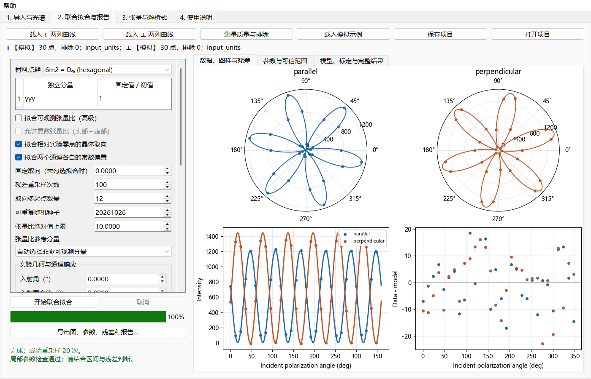

# SHG 实验分析工作台

面向二维材料反射 SHG 的 Windows 图形工具：逐角度光谱导入、信号提取、双通道联合拟合、张量模拟和可追溯报告。



## 不运行代码的使用方式

从 [GitHub Releases](https://github.com/nwh-phy/shg_simulation/releases) 下载 `SHGWorkbench-2.0.0.exe` 或便携 ZIP，双击即可，无需安装 Python。原有旧 EXE 不含这些功能。

程序提供四个页面：

1. **导入与光谱**：两列角度曲线、三列光谱长表、逐文件光谱目录；步长手动必填；预览原谱和信号／背景波段。
2. **联合拟合与报告**：平行／垂直通道共享取向和张量参数；多起点拟合、残差重采样、可辨识检查；PNG/PDF、参数、残差和 HTML 报告。
3. **张量与解析式**：32 个点群的独立参数，关联分量自动生成，数值与解析式使用同一定义。
4. **使用说明**：鼠标操作步骤、模型选择与错误处理。

首次可点击“载入模拟示例”学习操作。演示数据有明确标记，不是实验数据。

- [师兄使用说明](docs/使用说明.md)
- [数据格式](docs/experimental_data_format.md)
- [数学定义与证据边界](docs/physics_model.md)

## 研究约定

角度为已经换算好的入射偏振角，单位为度，不再乘二。目录导入按“起始角＋序号×手动步长”映射，不猜测步长、不补闭合点、不按周期合并测量。

原始数据只读。提取方法、背景、曝光／功率设置、排除点及理由、实际采样波长和输入文件 SHA-256 都保留。近似误差传播与参数区间依赖明确的噪声和物理模型，不是全部系统误差。

拟合面向接近正入射的面内电偶极薄片，可显式考虑各向同性单一基底或介质膜／基底的线性局域场。缺少光学常数和绝对标定时，只做相对图样分析，不从探测器计数声称获得绝对 χ。高 NA、显著面外响应、基底 SHG 和多来源相干干涉不在此模型范围内。

材料点群必须由使用者选择，软件不根据六瓣图样自动判定材料。张量比拟合固定参考分量及整体相位；不可辨识时不给参数区间。中心对称体材料的电偶极零张量不能用于排除表面或其他 SHG 机制。

## 开发运行

Python 3.11 的 Windows 64 位环境已用于本版构建。

```powershell
python -m pip install -r requirements.txt
python src/main.py
```

`python src/run_workbench.py` 是相同的完整程序入口。`python src/run_experimental_import.py` 只打开光谱导入工具；`python src/run_new_ui.py` 打开张量模拟页。

命令行提取与 GUI 共用实现：

```powershell
python src/import_shg_data.py 'D:/SHG数据/样品1/平行通道' --kind folder --step-deg 12 --target-nm 532 --method integral --half-width-nm 1 --background 510 525 --background 539 560 --output './exports/new_run'
```

上面的 12°、532 nm 和波段仅为示例，应替换为本次实验的实际设置；输出目录必须不存在。

## 验证与打包

```powershell
python -m pip install pytest==8.4.2
python -m pytest tests/ src/test_new_architecture.py -q
python tools/generate_tensor_catalog.py
python -m venv build/release-venv
& './build/release-venv/Scripts/python.exe' -m pip install -r requirements-release.txt
& './build/release-venv/Scripts/python.exe' tools/build_windows.py
```

构建脚本在新的 `dist/SHGWorkbench-2.0.0-时间戳/` 目录生成 EXE、构建清单、依赖许可证及操作说明，不覆盖旧版本。EXE 内置 `--self-test 新目录` 测试入口，检查实际打包运行时中的联合拟合、解析式、项目回读及报告导出，仅使用模拟数据。

测试覆盖点群生成操作不变性、SHG 内禀对称性、旋转、Voigt 一致性、符号／数值一致、Fresnel 极限、已知谱峰积分、误差传播、共享参数恢复、不可辨识、取消、失败回滚与 GUI 操作。

## 源码位置

- `src/experimental_data.py`：输入与谱线处理。
- `src/reflection_model.py`、`src/joint_fit.py`：反射模型与联合拟合。
- `src/project_io.py`：项目校验及报告导出。
- `src/ui/workbench.py`：中文工作台。
- `src/point_groups.py`、`tools/generate_tensor_catalog.py`：共同张量定义及可重复推导。

项目自身源码保留 [MIT 许可证](LICENSE)。组合 EXE 包含 GPLv3 版 PyQt5，按 GPLv3 条件分发；Qt 和其他依赖保留各自许可证。程序“帮助→版本与许可证”和便携包提供许可文本及对应源码来源；完整应用源码与构建方法随发布标签提供。[PyQt 官方许可说明](https://www.riverbankcomputing.com/software/pyqt/intro)
